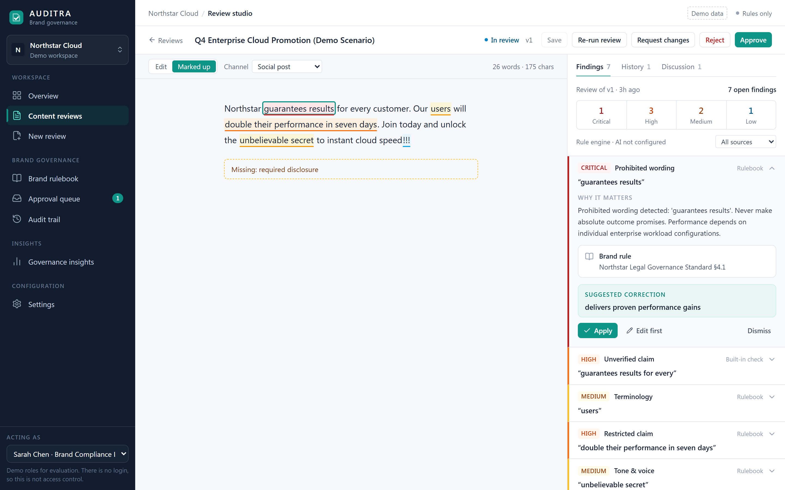

# AUDITRA — Brand Governance & Content Review

> **Techcircuit Round 2 — The Build** · Team **Quoding**

AUDITRA checks marketing copy against a brand's approved rules **before it ships**. Every finding points to the exact passage that triggered it and the configured rule or source behind it, offers a targeted correction, and feeds a human approval workflow with a full audit trail.

It is deliberately not a free-form writing assistant: automated checks inform the decision, and a named human reviewer makes it.

**Live demo:** https://auditra-bice.vercel.app/ (fictional demo data only; no login)  
**Repository:** https://github.com/RonitM2k06/Auditra



---

## What is implemented

| Area | What works today |
|---|---|
| **Workspaces** | Multiple brand workspaces with a switcher. A fictional demo brand, *Northstar Cloud*, is seeded on first start and can be reset from Settings. |
| **Brand rulebook** | Create, edit, enable/disable and delete rules in six categories (prohibited wording, terminology, required disclosure, restricted claim, tone & voice, style) with severity, match pattern, suggested replacement and source reference. Approved-claims registry. Import of `.txt`/`.md` guideline files: matching lines become rules (created **active**, so review them after import). |
| **Rule engine** | Deterministic checks with exact character offsets: prohibited phrases, preferred terminology, missing required disclosures, restricted claims, unverified outcome claims and style checks. |
| **Optional AI step** | If a Gemini, OpenAI or Anthropic key is set, the server also asks the model for findings. Model output is grounded: unknown rule IDs are discarded and offsets are re-located in the actual text. If the call fails, the review completes with rule findings and records `ai_status: failed`. |
| **Review studio** | Plain-text editor with marked-up view, severity-coded highlights, findings panel with severity counts and source filter, expandable findings (why it matters → brand rule / evidence → suggested correction), apply / edit-then-apply / dismiss, stale-review warnings, version history and discussion. |
| **Corrections & versions** | Applying a suggestion replaces only the matched passage, creates a new immutable version and is recorded in the audit trail. Re-running the review checks the new version. |
| **Approval workflow** | Server-enforced states: Draft → In review → Approved / Changes requested / Rejected. Requesting changes or rejecting requires a note. Approving with open critical/high findings shows an explicit warning. |
| **Approval queue** | Status counts, queue with highest severity and open findings per item, reviewer detail pane with copy, findings, discussion and decision actions. |
| **Audit trail** | Chronological timeline of server-recorded events (drafts, reviews, corrections, submissions, comments, decisions, rule changes) with actor, time, related content and labelled details. |
| **Overview & insights** | Dashboard KPIs, items needing attention, workflow status and open findings by severity; insights for findings by category, most-triggered rules, unresolved critical/high findings and decision turnaround. All computed from stored data. |
| **Demo roles** | “Acting as” switcher: Alex Rivers (Content Creator), Sarah Chen (Brand Compliance Lead), Workspace Admin. **This is a demo convenience, not authentication.** |

---

## Architecture

```
Browser ── React 19 + TypeScript SPA (Vite, Tailwind CSS, lucide-react)
   │        hash routes: #/overview, #/studio/<id>, #/rulebook, …
   │  JSON over /api
   ▼
FastAPI (single process, also serves frontend/dist)
   ├── routes/      brands · rules & claims · content · reviews · workflow · audit · dashboard · insights
   ├── rule_engine  deterministic matcher → findings with offsets + source references
   ├── ai_service   optional LLM step (Gemini → OpenAI → Anthropic), grounded + fail-safe
   └── SQLAlchemy 2 ─► SQLite (WAL, foreign keys) — auditra.db
```

**Review data flow:** the studio saves the text as a content version → `POST /api/content/{id}/review` runs the rule engine (and the AI step if configured) against the brand's active rules and claims → findings are stored against that version → applying a finding creates the next version → submit and decision endpoints move the item through the state machine → every step writes an audit event.

---

## Run it locally

Prerequisites: Python 3.10+ (verified on 3.12.7) and Node.js 18+ (verified on 24.16.0).

```bash
# 1. Backend dependencies
python -m venv venv
venv\Scripts\activate            # Windows   (macOS/Linux: source venv/bin/activate)
pip install -r requirements.txt

# 2. Build the frontend
cd frontend
npm install
npm run build
cd ..

# 3. Start the app (API + built frontend on one port)
uvicorn backend.main:app --host 127.0.0.1 --port 8000
```

Open **http://localhost:8000**. On first start the database file `auditra.db` is created and the Northstar demo workspace is seeded automatically.

For frontend development with hot reload, keep the backend running and run `npm run dev` in `frontend/` (Vite proxies `/api` to port 8000).

### Environment variables

The app reads these from the process environment (there is no `.env` loader, so set them in your shell or hosting platform):

| Variable | Default | Purpose |
|---|---|---|
| `DATABASE_URL` | `sqlite:///./auditra.db` | SQLAlchemy database URL. |
| `GEMINI_API_KEY` | empty | Enables the AI step via Gemini (checked first). |
| `OPENAI_API_KEY` | empty | Enables the AI step via OpenAI if no Gemini key. |
| `ANTHROPIC_API_KEY` | empty | Enables the AI step via Anthropic if neither of the above. |

PowerShell example: `$env:GEMINI_API_KEY = "..." ; uvicorn backend.main:app --port 8000`

With no key set, `/api/health` reports `ai_engine: deterministic_fallback`, the UI shows **Rules only**, and every review runs the rule engine alone. Keys are only read server-side and are never sent to the browser.

---

## Tests

```bash
venv\Scripts\python -m pytest -q tests
```

`tests/conftest.py` points `DATABASE_URL` at a temporary SQLite file, so test runs never write into the demo database.

**Verified on 24 Oct 2026:**
- Backend test suite: **11 passed** (rule engine positives and negatives, workspace seeding, content lifecycle and corrections, creation without `brand_id` in the body, dashboard/insights, guideline upload, claims, state-machine enforcement, end-to-end judge journey).
- Frontend production build (`npm run build`, which includes `tsc -b`): **succeeds**.
- Ad-hoc HTTP smoke script (not committed) against a running server on a throwaway database: 21/21 checks (rule create/edit/validation, content creation, rule findings with offsets and source, deterministic fallback, correction → v2, re-review, state machine, dashboard/queue consistency, comments, approval, version history, audit lifecycle, 404 handling), plus persistence of brand, status and audit trail across a server restart.
- AI failure path: with an invalid provider key, reviews still complete with rule findings and `ai_status: failed`. **A successful live AI call was not tested** (no provider key available).
- Browser check (Chrome via Playwright) of every screen at 1440×900, 1024×768, 768×1024 and 375×812: no console errors, no failed API calls, no horizontal overflow. Full creator → reviewer journey completed in the UI.

---

## Demo walkthrough (about 3 minutes)

1. **Overview** — open http://localhost:8000. See KPIs, what needs attention and open findings by severity.
2. **New review** — click *New review*, then *Use sample copy* (fictional promo text that breaks several rules on purpose), then **Run review**.
3. **Inspect a finding** — expand *Prohibited wording · “guarantees results”*: the explanation, the brand rule (*Northstar Legal Governance Standard §4.1*) and the suggested correction. Clicking a finding jumps to its passage.
4. **Apply the correction** — click **Apply**. A new version is saved; click **Re-run review** to confirm the issue is gone.
5. **Submit for approval** — confirm the warning about remaining open findings.
6. **Decide as reviewer** — switch *Acting as* (bottom of the sidebar) to **Sarah Chen**. Use *Request changes* (note required) or *Approve* in the studio or the **Approval queue**.
7. **Trace it** — open **Audit trail** to see each step with actor, time and version. Refresh: everything persists.

To return the demo to its starting state: **Settings → Reset demo workspace**. This deletes and re-seeds only the brand with slug `northstar`; other workspaces are untouched.

---

## Deployment

AUDITRA runs as a single Python web process that serves both the API and the built SPA, so any host that can run `uvicorn` works (e.g. Render, Railway, Fly.io, a VM):

1. Build step: `pip install -r requirements.txt && cd frontend && npm ci && npm run build`
2. Start command: `uvicorn backend.main:app --host 0.0.0.0 --port $PORT`
3. Set provider keys as platform secrets if you want the AI step.
4. SQLite needs a **persistent disk** mounted where `DATABASE_URL` points (e.g. `sqlite:////data/auditra.db`); on ephemeral filesystems data resets on redeploy.

### Vercel (current)

The repo is ready to import into Vercel as-is (`vercel.json` + `api/index.py`):

1. vercel.com → **Add New → Project** → import `RonitM2k06/Auditra`. Leave Framework Preset as **Other** and Root Directory as `./`; `vercel.json` supplies the build settings.
2. Optionally add `GEMINI_API_KEY` / `OPENAI_API_KEY` / `ANTHROPIC_API_KEY` under Environment Variables.
3. Deploy. The SPA is served statically from `frontend/dist`; every `/api/*` call goes to the FastAPI app as a Python serverless function.

**Data caveat:** Vercel functions have no persistent disk, so SQLite lives in `/tmp` and is re-seeded with the Northstar demo on each cold start; edits may vanish between requests that hit different instances. For persistent data, set `DATABASE_URL` to a hosted Postgres (e.g. Vercel Postgres / Neon) and add a driver such as `psycopg[binary]` to `requirements.txt`.

The `Dockerfile` still works for container hosts.

---

## Known limitations and security notes

- **No authentication or authorisation.** The role switcher is for demonstration only; anyone with access can act as any role. Do not expose a deployment with real content without adding auth.
- **CORS allows all origins** (`CORS_ORIGINS = ["*"]` in `backend/config.py`); restrict it for a real deployment.
- The audit trail is an append-only *application* log in an ordinary database table, not a tamper-proof ledger.
- Guideline import accepts UTF-8 text/Markdown only and creates **active** rules immediately — an imported document takes effect before anyone reviews it. No PDF/DOCX extraction.
- No structured evaluation yet (detection rate, false positives, reviewer agreement) and no user interviews.
- The rule engine is pattern-based: it does not understand paraphrases. The AI step can catch more, but its findings are marked as AI-assisted and may need human verification.
- The backend still computes a weighted `risk_score`; it is shown only in audit details, not as a verdict in the UI.
- Text content only; no images, video or rich text.
- SQLite is single-node; use a server database for concurrent multi-user production use.

---

## Round 3 roadmap

1. **Multimodal brand governance** — check banners and social creatives for palette, logo usage, contrast and OCR'd on-image text against the same rulebook.
2. **Evidence-grounded brand knowledge and claim verification** — retrieve from approved source documents so every claim is matched to a dated, attributable source.
3. **Enterprise governance and publishing integrations** — SSO and real roles, multi-step approval policies, and connectors so only approved versions reach CMS and scheduling tools.

---

## Repository layout

```
backend/            FastAPI app, models, rule engine, AI service, seed data, routes/
frontend/           React + TypeScript SPA (src/pages, src/components)
tests/              pytest suite (isolated database via conftest.py)
docs/screenshots/   screenshots of the running app (1440×900, demo workspace)
generate_submission_pdf.py   builds AUDITRA_Round2_Submission.pdf
```

Team **Quoding** — Arya Kashyap (Team Leader), Ronit Mongia, Moli Verma.
